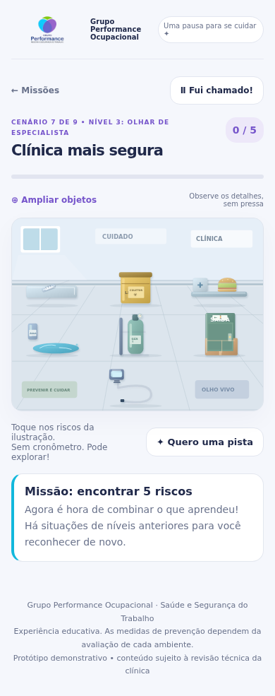
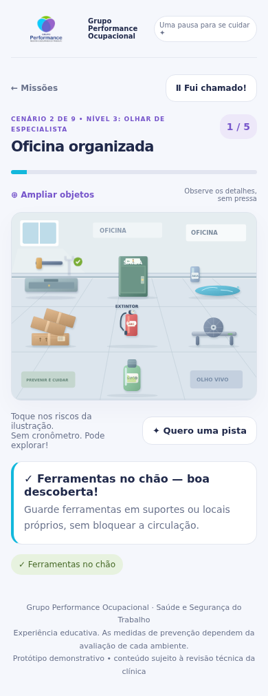

# Olho Vivo • Grupo Performance Ocupacional

> **Diversão que vira prevenção** — *Olho vivo. Cadê o perigo?*


-20294a)


Experiência educativa interativa de **Saúde e Segurança do Trabalho (SST)** desenvolvida para o **Grupo Performance Ocupacional**. O jogo convida colaboradores, pacientes e visitantes a explorar diferentes ambientes de trabalho, identificar situações de risco no dia a dia e transformar cada espaço em um lugar mais seguro — sem pressa, sem cadastro e direto no celular ou computador.

🌐 **Acesse online (GitHub Pages):**  
👉 **[https://performance-itatiaiucu-commits.github.io/jogoperformance/](https://performance-itatiaiucu-commits.github.io/jogoperformance/)**

---

## Prévia da Experiência

| Cenário Clínico (Exploração) | Oficina Organizada (Risco Solucionado) |
| :---: | :---: |
|  |  |

---

## Principais Recursos

- **9 Ambientes Ocupacionais e 27 Missões:** da clínica à construção civil, cobrindo diferentes rotinas operacionais e administrativas.
- **Progressão em 3 Níveis com Revisão Espaçada:**
  - 🌱 **Nível 1 — Primeiro olhar:** 3 riscos com pistas diretas e destaque visual pulsante.
  - 🔎 **Nível 2 — Olhar atento:** 4 novos detalhes do ambiente com pistas orientativas.
  - ⚡ **Nível 3 — Olhar de especialista:** 5 riscos combinando aprendizados anteriores com estímulo à reflexão preventiva.
- **38 Riscos Ilustrados em SVG com Transformação Visual:** ao tocar em um risco, o cenário se corrige imediatamente e exibe uma orientação prática de prevenção.
- **Modo de Ampliação (`⊕ Ampliar objetos`):** zoom dedicado (`160%` em desktop / `180%` no celular) com rolagem horizontal suave para observar detalhes sem esforço.
- **Botão `Ⅱ Fui chamado!`:** pausa imediata pensada para salas de espera de clínicas ocupacionais e pausas rápidas no expediente.
- **Privacidade Total (LGPD):** sem cadastro, sem coleta de dados pessoais e sem cookies externos — o progresso fica salvo apenas no `localStorage` do navegador do usuário.
- **Acessibilidade Integrada:** suporte completo a teclado (`Tab`, `Enter`, `Espaço`, `Esc`), gestão de foco em modais e anúncios dinâmicos via `aria-live` para leitores de tela.

---

## Os 9 Cenários do Jogo

| # | Ambiente | Subtítulo | Conquista Desbloqueada |
| :-: | :--- | :--- | :--- |
| **1** | 🖥️ **Escritório em alerta** | *O perigo também usa roupa de escritório.* | 🏆 Olhar de águia |
| **2** | 🛠️ **Oficina organizada** | *Ferramentas no lugar. Atenção nos detalhes.* | 🏆 Mestre da oficina |
| **3** | 🍳 **Cozinha sem sustos** | *A receita certa começa na prevenção.* | 🏆 Chef da prevenção |
| **4** | 🏗️ **Construção consciente** | *Cada etapa merece um olhar atento.* | 🏆 Guardião da obra |
| **5** | 📦 **Estoque em ordem** | *Organização que abre caminhos.* | 🏆 Expert da organização |
| **6** | 🧹 **Limpeza com cuidado** | *Tudo limpo. Nada de improviso.* | 🏆 Agente do cuidado |
| **7** | 🩺 **Clínica mais segura** | *Cuidar de quem cuida também importa.* | 🏆 Aliado do cuidado |
| **8** | 🚚 **Transporte atento** | *Prevenção acompanha cada trajeto.* | 🏆 Piloto da prevenção |
| **9** | 🌤️ **Trabalho ao ar livre** | *Um olhar atento, faça chuva ou sol.* | 🏆 Explorador consciente |

---

## Como Executar

### 1. Online (Recomendado para QR Codes, SIPAT e Campanhas)
Basta compartilhar ou gerar um QR Code apontando para:
```text
https://performance-itatiaiucu-commits.github.io/jogoperformance/
```

### 2. Execução Local / Offline (Totens, Tablets ou Computadores sem Internet)
Como toda a aplicação (HTML, CSS, JS, logotipo e ilustrações SVG) está contida no arquivo `index.html`:

1. Baixe ou clone o repositório:
   ```bash
   git clone https://github.com/performance-itatiaiucu-commits/jogoperformance.git
   ```
2. Abra o arquivo `index.html` diretamente em qualquer navegador moderno (Chrome, Edge, Safari ou Firefox), ou sirva localmente com Python:
   ```bash
   cd jogoperformance
   python3 -m http.server 8000
   ```
   Em seguida, acesse `http://localhost:8000`.

---

## Estrutura do Repositório e Documentação

```text
jogoperformance/
├── index.html                        # Aplicação web completa e autônoma (V3)
├── README.md                         # Visão geral e instruções rápidas do projeto
├── LICENSE                           # Direitos autorais e termos de uso institucional
├── CHANGELOG.md                      # Histórico de evolução das versões (V1 → V3)
├── CONTRIBUTING.md                   # Diretrizes para revisão técnica e manutenção
├── SECURITY.md                       # Política de segurança e privacidade (LGPD)
├── .gitignore                        # Exclusão de logs e arquivos temporários
├── .nojekyll                         # Configuração de publicação estática no GitHub Pages
└── docs/
    ├── GUIA_PEDAGOGICO_SST.md        # Metodologia e catálogo completo dos 38 riscos
    ├── ARQUITETURA_TECNICA.md        # Estrutura técnica do código, SVG e persistência
    └── screenshots/                  # Capturas de tela da interface mobile
        ├── clinica-mais-segura-mobile.png
        └── oficina-organizada-mobile.png
```

### Documentos de Referência
- 📘 **[Guia Pedagógico e Catálogo Completo de Riscos (SST)](docs/GUIA_PEDAGOGICO_SST.md)** — ideal para revisão clínica/técnica dos textos e planejamento de ações educativas.
- 🛠️ **[Arquitetura Técnica e Guia de Manutenção](docs/ARQUITETURA_TECNICA.md)** — detalhamento das camadas do código, coordenadas SVG, acessibilidade e edição de cenários.
- 🤝 **[Guia de Contribuição](CONTRIBUTING.md)** — fluxo para ajustes e melhorias.
- 🔒 **[Segurança e Privacidade (LGPD)](SECURITY.md)** — garantias de funcionamento estático sem coleta de dados.
- 📋 **[Histórico de Versões](CHANGELOG.md)** — registro das entregas do projeto.

---

## Nota Técnica e Direitos Autorais

> **Experiência educativa.** As medidas de prevenção dependem da avaliação técnica de cada ambiente de trabalho e dos procedimentos específicos de cada organização. Protótipo demonstrativo sujeito à revisão técnica do **Grupo Performance Ocupacional**.

© 2026 **Grupo Performance Ocupacional · Saúde e Segurança do Trabalho**. Todos os direitos reservados. Consulte o arquivo [`LICENSE`](LICENSE) para mais informações.
